# Terminator

<p align="center">
  <strong>A Linux terminal emulator and shell built from the ground up in C</strong><br>
  X11 interface · independent tabs · thread and process modes · no PTY · no shell delegation
</p>

Terminator combines an X11 window with a shell implementation that parses and
runs commands itself. Its design uses Linux processes, threads, pipes, `dup2`,
signals, polling, synchronization, and shared memory.

Build from source on Linux with `make`; the repository contains the source and
setup instructions.

## First look

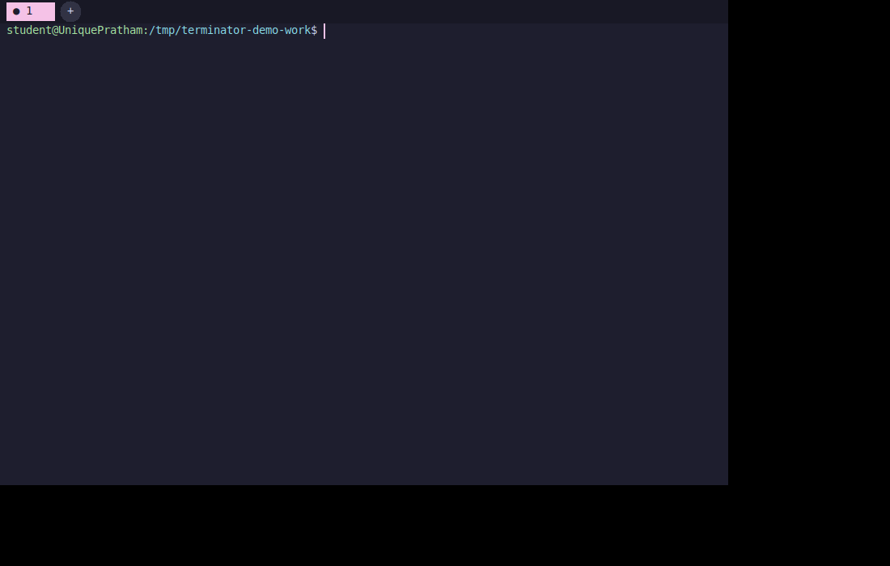

The gallery shows the application, command features, and tab management.

## Features

### 1. X11 window and tabs

The GUI draws the prompt, input, output, and scrollback in X11. Tabs can be
created with **+** or `Ctrl+Shift+T`, selected with the mouse or tab shortcuts,
and closed with their close control or `Ctrl+Shift+W`. Each tab retains its
shell state and continues running while hidden. The app caps tabs at 16.
IDs remain attached to open tabs; a new tab reuses the lowest vacant ID but
still appears at the end of the strip in creation order. For example, after
closing tabs 1, 2, and 3 while 4 and 5 remain, five new tabs are labeled
1, 2, 3, 6, and 7 after 4 and 5.

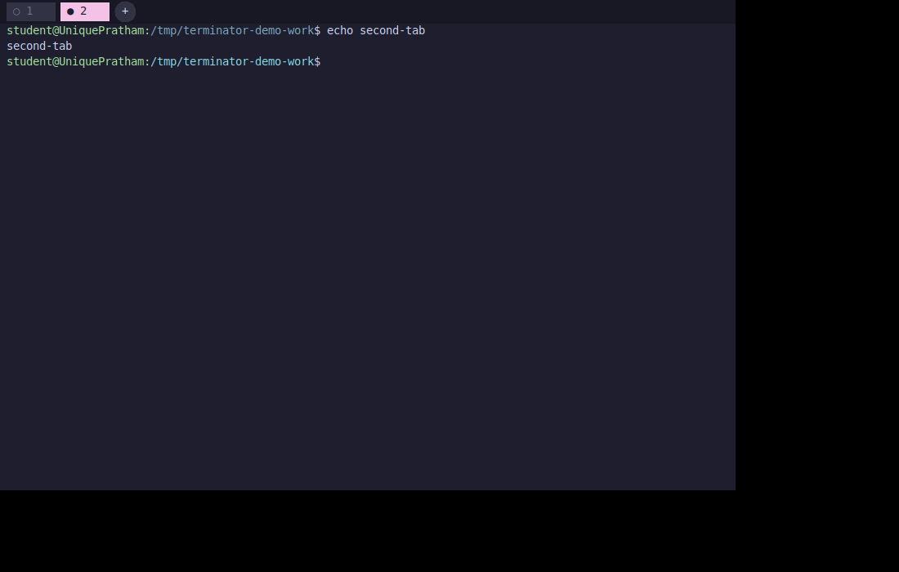

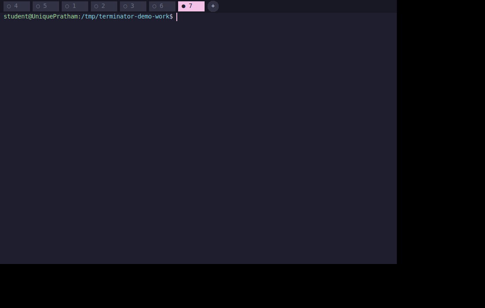

### 2. Built-in and external commands

State-changing commands such as `cd`, `exit`, `history`, `jobs`, `fg`, `bg`,
`source`, and `multiWatch` are handled inside the shell. External programs are
started as children with `fork()` and `execvp()`. `$?` carries the last status;
an unknown command reports an error and leaves the tab usable.

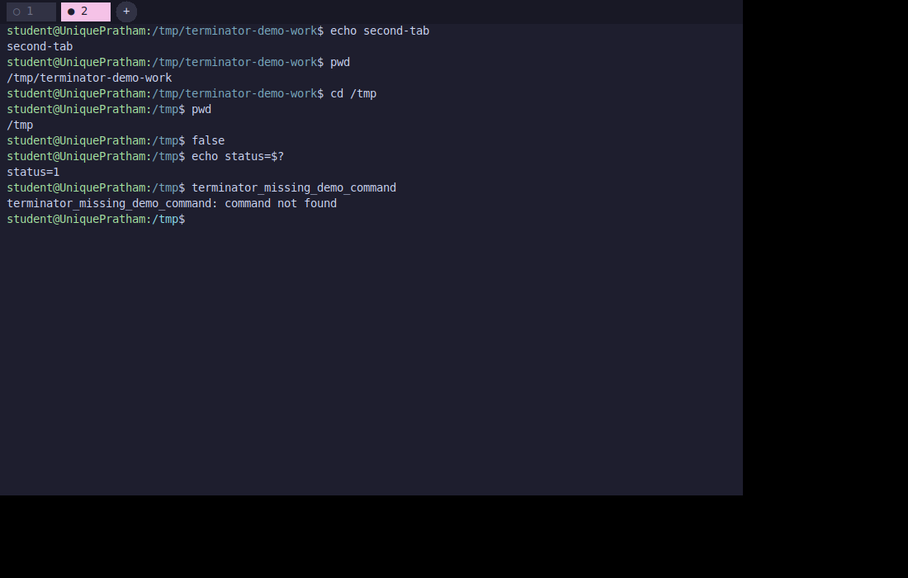

### 3. Multiline input and quoting

An unfinished quote, command substitution, or trailing backslash continues at
the `>` prompt. Single quotes stay literal; double quotes permit variable and
command expansion. Nested `$()` and backtick substitutions are evaluated from
the inside out.

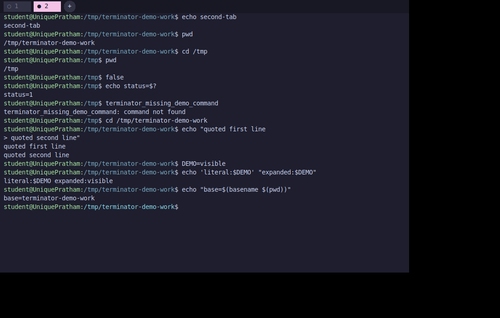

### 4. Input and output redirection

`<` and `>` are opened and connected in the child with `dup2()`. A missing
input file is reported before the command runs. Combined input and output
redirection is supported.

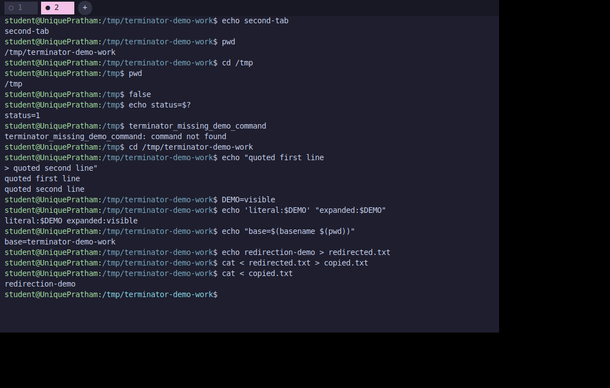

### 5. Pipelines

Pipelines of multiple commands are connected with `pipe()`. Each stage runs in
its own child, and all unused pipe descriptors are closed so EOF reaches the
last command.

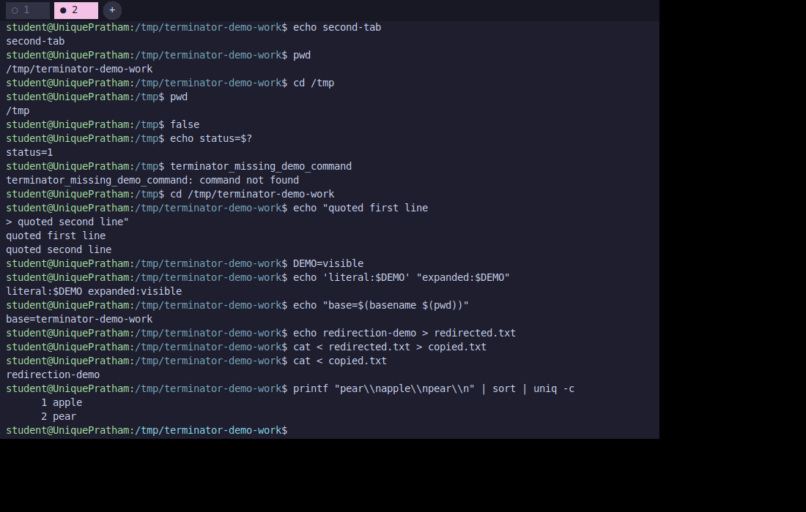

### 6. `multiWatch`

`multiWatch` starts the requested commands concurrently, reads their output
without busy-waiting, and reruns them at the configured interval. `Ctrl+C`
stops its children and returns to the prompt.

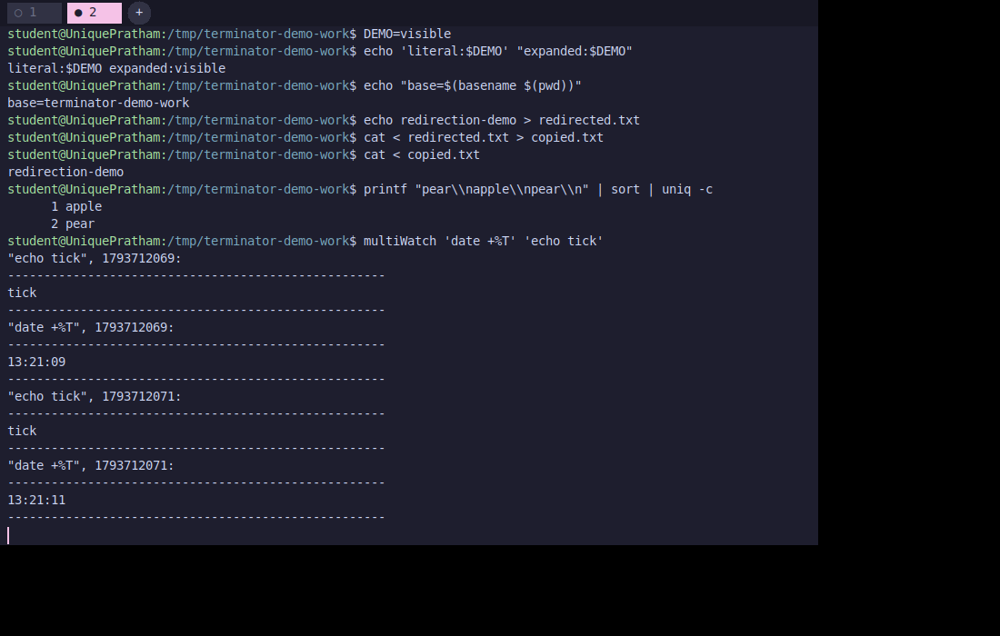

### 7. Configurable hotkeys and line editing

Bindings are read from `~/.terminatorrc`, created with defaults on first run.
Invalid or conflicting bindings fall back to defaults. Cursor movement, Home,
End, history navigation, deletion, completion, clear, clipboard, and insert /
overwrite cursor modes are supported.

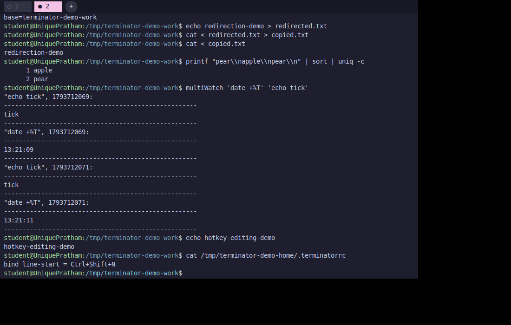

### 8. Signals and job control

`Ctrl+C` interrupts a foreground job and `Ctrl+Z` suspends it without stopping
Terminator. `jobs`, `fg`, and `bg` inspect and manage background or stopped
jobs.

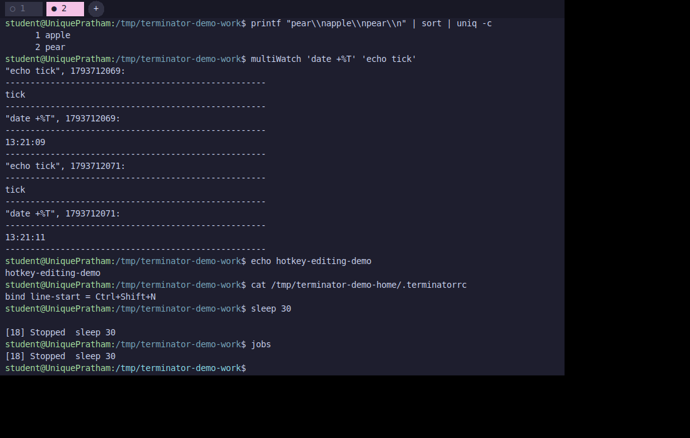

### 9. Shared searchable history

Tabs use one synchronized history store. It keeps up to 10,000 commands;
`history` displays the latest 1,000. `Ctrl+R` searches for the latest exact
match, otherwise the best sufficiently long common substring.

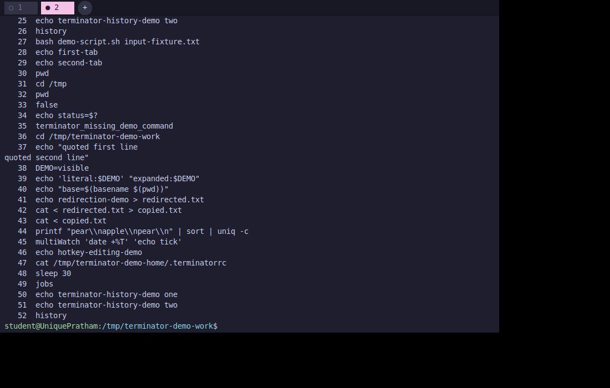

### 10. File-name completion

Tab completes names from the current directory. One match completes directly;
multiple matches extend their common prefix and then offer sorted, numbered
choices. Text after the cursor is preserved.

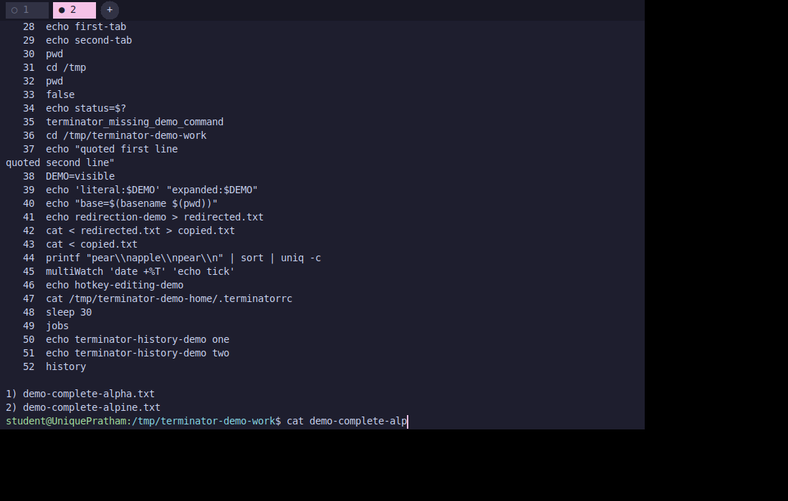

### 11. Script interpreter

Script files are interpreted by this project. The supported subset includes
comments, multiple commands, variables, positional parameters, command
substitution, pipelines, redirection, nested `if` / `elif` / `else` / `fi`,
tests, and `exit`. `./script.sh`, `bash script.sh`, and `source script.sh` are
recognized forms; none delegates script parsing to Bash.

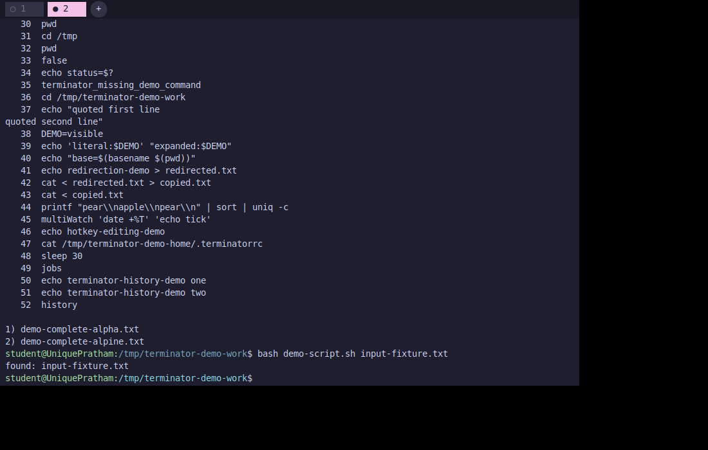

## Run in both modes

Each tab has an independent shell context. In thread mode, tabs use worker
threads in one process. In process mode, the GUI forks one worker process per
tab and communicates through framed pipes; history is shared through memory
protected by a process-shared semaphore.

```sh
./terminator                    # thread mode (default)
./terminator useProcess=True    # process mode
```

Both modes launch external commands as child processes. The GUI is the only
part that accesses X11.

## Install and build

Requirements: Linux, a C11 compiler, GNU Make, X11/Xft development files, and
an X server (a desktop session or Xvfb).

On Debian or Ubuntu:

```sh
sudo apt update
sudo apt install build-essential make pkg-config libx11-dev libxft-dev
```

Build and run the headless regression suite:

```sh
make
make test
```

To run without a desktop, install `xvfb` and `xdotool`, start a virtual X
server, and set `DISPLAY`:

```sh
sudo apt install xvfb xdotool
Xvfb :1 -screen 0 1024x768x24 -nolisten tcp &
export DISPLAY=:1
./terminator
```

## Design and learning resources

- [Architecture](docs/architecture.md) — event loop, workers, IPC, state ownership.
- [Design decisions](docs/design-decisions.md) — choices and constraints.
- [System-call map](docs/syscall-map.md) — where the OS interfaces are used.
- [Demo guide](docs/demo-guide.md) — commands to demonstrate each task.
- [Setup and running](docs/setup-and-running.md) — platform-specific instructions.
- [Tests](docs/testing.md) — coverage, observed results, and limits.
- [Known limitations](docs/implementation-plan.md#known-gaps) — shell subset and scope.

## Validation and limitations

The automated suite currently reports **243 passed, 0 failed**. It covers the
shell core and tab workers in both modes. It is not a formal proof that every
interaction on every Linux desktop is defect-free.

Terminator implements a documented shell subset, not all of Bash. It does not
use PTYs or implement terminal escape-sequence semantics, so full-screen
interactive programs such as `vim` are not guaranteed to work.
Extended redirection forms such as `2>&1`, shell functions, loops, and heredocs
are outside the current scope.

## License

No license has been selected. All rights remain with the project authors
unless a license is added.
