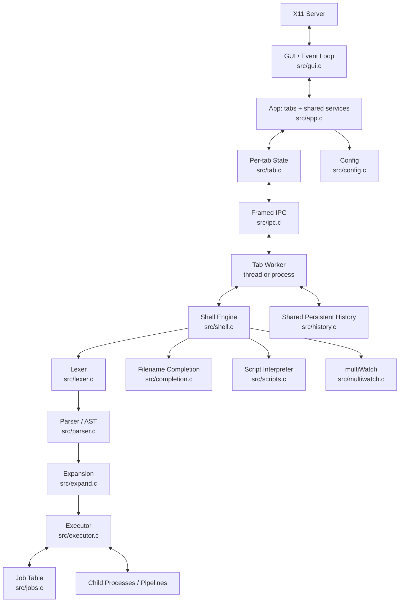

# Architecture

## Overview

## Module boundaries

The codebase is split into **GUI-free core modules** and a **GUI layer**:

- Core (linkable into the headless test binary): `util`, `lexer`, `parser`,
  `expand`, `executor`, `jobs`, `history`, `completion`, `config`, `scripts`,
  `shell`, `multiwatch`, `ipc`, `tab`.
- GUI layer (the only code that includes X11 headers): `gui`, plus `app` and
  `main`.

This split is what allows `make test` to run without an X server.

## Ownership rules
- The GUI owns all Xlib resources and rendering.
- A tab owns its input buffer, logical cwd, scrollback, continuation buffer,
  status, and job metadata.
- The shell engine owns parsing/execution contexts and variables. A standalone
  shell creates its own job table; the application injects a shared one via
  `shell_set_jobs()` (the shell tracks ownership so it frees only what it
  created).
- The history service owns persistence and synchronization.
- The executor owns transient pipe descriptors and child lifecycle until
  ownership is transferred to the job table.
- Every descriptor has one documented owner and a cleanup path.

## Event loop
The GUI waits on the X connection descriptor and all active tab output
descriptors with `poll()`. It drains pending X events, reads available output
until no more data, updates tab models, reaps children non-blockingly, and
redraws dirty regions. There are no synchronous waits in GUI handlers.

## Thread mode
One process; one shell worker thread per tab. A mutex protects shared history.
Because current directory and file descriptor tables are process-wide, each tab
keeps a logical cwd and applies cwd/redirection only in forked children. Xlib
calls stay in the GUI thread.

## Process mode
The GUI remains the parent. Each tab worker is a child process. The GUI and
worker exchange framed messages (`ipc_header_t`: type, tab id, payload length)
over pipes; read/write-all helpers handle partial transfers. History lives in
shared memory guarded by a process-shared semaphore. Tab workers are reaped and
worker failures are isolated.

## Shutdown
Stop accepting new commands; request tab workers to stop; signal and reap owned
jobs; close IPC and output descriptors; join threads or reap tab processes;
persist history; destroy X11 resources; release shared mappings and
synchronization objects.
